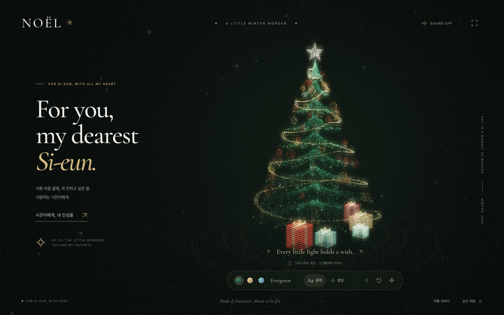

# NOËL — A little winter wonder

사랑하는 시은이에게 보내는 편지를 담은, 문자와 빛의 인터랙티브 크리스마스트리. **HTML · CSS · 순수 JavaScript / WebGL**로 구현했으며, 프레임워크나 런타임 CDN, API 키가 필요하지 않습니다.

**감상하기:** [NOËL — 사랑하는 시은이에게](https://rem0116kjh.github.io/love/)



## 실행

**파일 하나로 열기:** `dist/noel-for-sieun.html`에는 폰트, 스타일, 코드가 모두 들어 있습니다. 이 파일만 복사해 브라우저에서 열 수 있습니다. 앱 설치와 인터넷 연결이 필요하지 않습니다. `python3 build.py`로 소스 변경 후 다시 만들 수 있습니다.

`index.html`을 브라우저에서 열면 바로 감상할 수 있습니다. 일관된 로컬 저장소와 미리보기를 위해 로컬 서버 실행을 권장합니다.

```sh
python3 serve.py
```

브라우저에서 <http://127.0.0.1:4173>을 엽니다. 포트가 사용 중이면 `python3 serve.py --port 4174`로 변경할 수 있습니다.

## 작품 안에서

- **시은이에게, 내 진심을**: 미안함과 고마움, 행복하게 해 주고 싶은 마음을 담은 편지. 편지를 읽는 동안 트리가 빛나는 하트로 변합니다.
- 드래그 또는 **← →**: 나무를 3D로 회전
- 스크롤 / 두 손가락 터치 / **+ −**: 확대·축소
- **문자 / 별빛**: ASCII 글리프와 입자 표현 전환
- 세 가지 색상: **Evergreen · Champagne · Aurora**
- 편지 아래 **우리의 소원도 하나 남겨 볼까?**: 트리의 문자가 하트로 변하며 소원을 표시
- **Space**: 움직임 멈추기 / 재생
- **R**: 바닥에서 트리 다시 피우기
- **B**: 입자를 흩뿌렸다가 다시 모으기
- **M**: 브라우저에서 직접 합성하는 오리지널 겨울 음악
- **F**: 전체 화면
- **순간 저장**: 현재 작품을 PNG 엽서로 다운로드

소원은 `localStorage`의 `noel.private-wish.v1` 키 하나에만 저장됩니다. 소원 창의 **간직한 소원 지우기**로 삭제할 수 있습니다. 저장이 차단되어도 작품과 소원 연출은 작동합니다. 네트워크 전송이나 분석 도구는 없습니다. 소원은 이미지 내보내기에 자동 포함되지 않습니다.

OS의 동작 줄이기 설정에서는 처음부터 움직임을 멈춥니다. 재생 버튼으로 직접 시작할 수 있습니다. 음악은 사용자가 켰을 때만 재생합니다. 페이지가 보이지 않으면 렌더링과 음악을 쉽니다. WebGL과 브라우저 하드웨어 가속이 필요하며, 사용할 수 없으면 복구 안내가 표시됩니다.

## 구성

- `index.html`: 의미 있는 UI, 접근성 레이블, 네이티브 대화상자
- `styles.css`: 반응형 레이아웃과 시각 디자인
- `scene.js`: 절차적 나뭇가지·장식·별·선물·눈, 문자 아틀라스, WebGL 셰이더, 블룸, 하트 변형
- `app.js`: 상호작용, 소원, 로컬 저장, Web Audio 음악, PNG 내보내기
- `assets/`: 자체 SVG 아이콘 및 로컬 폰트
- `qa/`: 디자인 기준과 실제 브라우저 검증 기록

## 영감과 라이선스

참고 영상: [@dwcminh.ascii — ASCII Christmas Tree](https://www.instagram.com/p/DfoWsojSWA2/). 영상의 3초·9초·17초 장면을 브라우저에서 확인해 성장하는 ASCII 트리, 금빛 리본, 붉은 장식, 눈과 회전의 아이디어를 참고했습니다. 영상, 원본 코드, 음원은 프로젝트에 포함하지 않았습니다. 나무의 형상, 렌더러, 음악, 디자인은 이 프로젝트에서 새로 작성했습니다.

Cormorant Garamond 폰트는 SIL Open Font License 1.1에 따라 로컬로 포함했습니다. `assets/FONT-LICENSE.txt`를 참고하세요.

## 검증

`qa/browser-checks.json`에 실제 Chromium 통합 검증 결과가 있습니다. 렌더링, 회전·확대, 팔레트·표현 모드, 음악 켜기/끄기, 편지·하트, 소원 입력·보존·삭제, PNG 다운로드, 터치 확대, 동작 줄이기, 저장소 차단, WebGL 연결 끊김·복구를 확인합니다. `qa/`의 캡처는 데스크톱과 모바일 브라우저 에뮬레이션에서 촬영했습니다. 실제 iPhone/Android/Safari 기기 검증은 수행하지 않았습니다.
